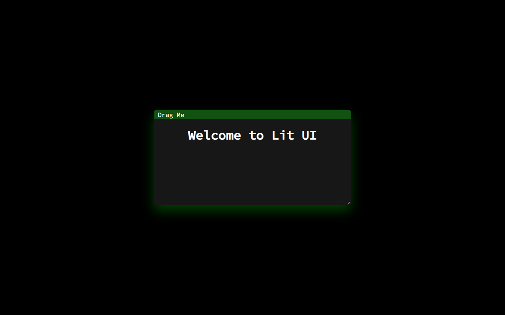

# Lit UI

A small HTML, CSS, and JavaScript demo of a draggable, resizable panel in the browser.

## What it does

- Displays a simple floating panel with a drag handle
- Lets you move the panel by dragging its header
- Lets you resize the panel with the browser's native resize handle

## Run it

Open `LitUI/lit.html` in a browser. There is no build step or installation required.

The page loads Source Code Pro from Google Fonts, so that font requires an internet connection. It falls back to a system monospace font if it cannot load.

## Current scope

This is an early UI experiment. It currently contains the standalone panel demo; it is not packaged as a bookmarklet. Dragging uses mouse events, so touch and keyboard controls are not implemented.

`Source_Code_Pro.zip` is included in the repository, but the page currently loads the font from Google Fonts instead of using that archive. There is no license file in the repository yet.